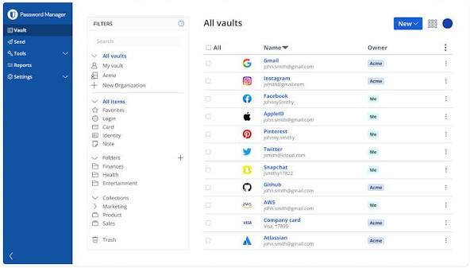
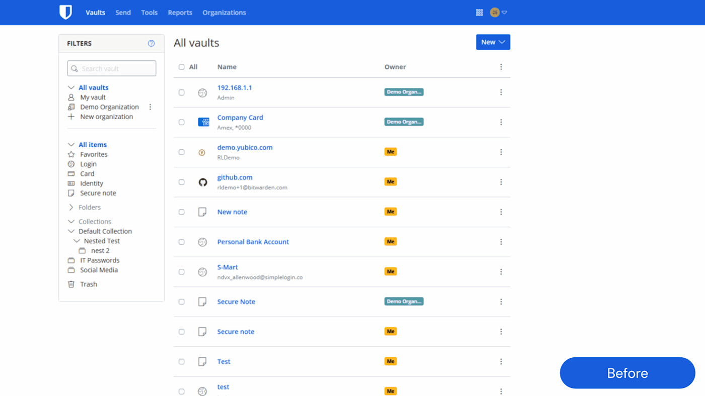
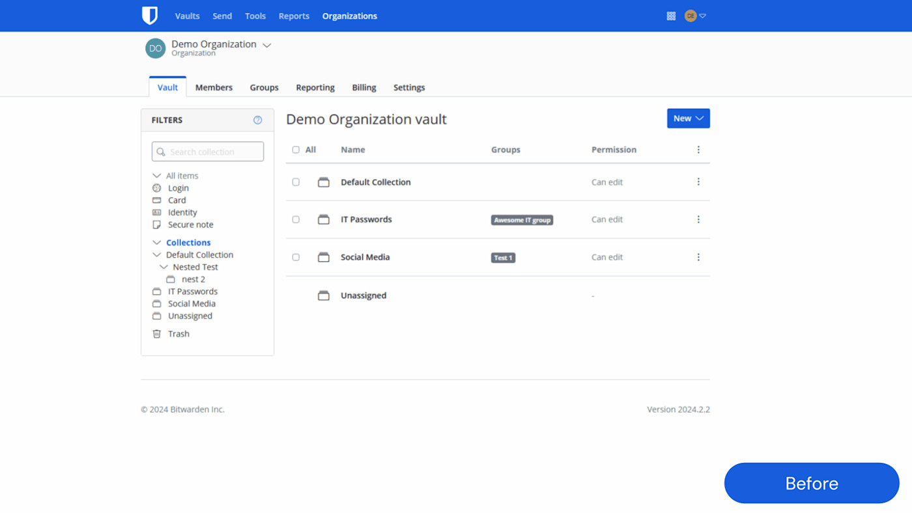

# bitwarden password generator

Bitwarden is a password manager for people who want one encrypted store instead of a browser full of reused logins. The bitwarden vault holds sites, notes, cards, and identities. A bitwarden extension on the browser can fill those items and offer a new secret before you save the account.

The bitwarden open source server is the part you can read, build, and host. Clients talk to it over the same item API whether you use the hosted service or a machine you operate. The bitwarden password generator sits in that flow: it proposes a unique password, the vault stores the ciphertext, and the extension offers it the next time the form appears.

This tree is a flattened look at the vault API, identity, billing plans, icons, and the generator policy. It is not a second product. The name on the title is the product.



## Features

A personal bitwarden vault can grow without a device cap on the free plan. You add a login once, and the same record is available in the web vault, the desktop app, and the mobile apps. Sharing moves up to an organization: collections, groups, and roles decide who can see an item.

The bitwarden extension is the daily surface. It matches the site, fills the username, and can fill a password it just created. Autofill on Android and similar mobile flows uses the same vault, not a separate list. Passkeys can sit beside the password when the site offers WebAuthn.

The bitwarden password generator is a policy, not a sticker. Length, digits, symbols, and passphrase word count are choices you make per item or lock down for an organization. The policy flag lives next to other org rules in [org_policy.rs](models/org_policy.rs). Item bodies themselves are modeled in [cipher.rs](models/cipher.rs) and served from [ciphers.rs](api/ciphers.rs).

Folders keep a personal tree. Organizations use collections. Sends move a secret to someone who does not need an account. Emergency access lets a trusted person request the vault after a waiting period. Two step login can be an authenticator code, email, a security key, or a passkey.

| Plan | Price | What you get |
| --- | --- | --- |
| Personal Free | $0 | Unlimited passwords and devices for one person |
| Personal Premium | $1.65 a month | Breach reports, TOTP, encrypted attachments |
| Families | $3.99 a month | Up to 6 people and shared vaults |
| Teams | $4 per user a month | Organization features, billed yearly |
| Enterprise | $6 per user a month | Larger organizations, billed yearly |

Premium is also listed as $19.80 a year. Families is $47.88 a year. Teams and Enterprise in the brief are the annual per user rates.

A generated password can be a random string or a passphrase of several words. The string is easier to satisfy a site that demands a symbol. The passphrase is easier to read aloud when you must type it on a television or a console. Save the result into the item immediately. A generator history that lives only on one laptop is not the vault.

Character sets are a product choice you can narrow. Drop ambiguous glyphs if you expect to type the password from a phone screen. Keep digits if the site rejects a letters only secret. The organization policy can forbid a short result even when the personal default would allow it.

| Term | In this product |
| --- | --- |
| bitwarden vault | Encrypted items, folders, and attachments |
| bitwarden extension | Browser fill, capture, and generator |
| bitwarden password generator | Unique passwords and passphrases |
| bitwarden open source | Server and client code you can inspect |
| Passkey | WebAuthn login stored with the item |
| Send | A short lived secret outside the vault |

Website icons are fetched for the list view so a row is recognizable. Attachments stay encrypted. A personal API key is for scripts that should not see the master password. Event logs record organization activity. An admin can reset a member password only where policy allows it.

Directory sync is for a business that already has users in an identity provider. It does not replace the master password on a personal vault. Policies can require the generator, two step login, or a single organization.

The web vault needs a secure context. Treat HTTPS as part of the product, not an optional extra. A reverse proxy in front of the service is the usual way to present that certificate.

## Developer Documentation

The server side is C# on ASP.NET with SQL for the hosted shape, and the lighter API tree in this pack is Rust. Both describe the same job: accept an authenticated call and return ciphertext the client can decrypt. Start with [build.rs](build.rs) for the Rust build hook, `Api.csproj` for the API project, and `Program.cs` plus `Startup.cs` for the process entry.

Style is whatever the repo already enforces. Do not invent a second formatter. The solution list is `bitwarden-server.slnx`. Shared build settings are `Directory.Build.props`. The SDK pin is `global.json`.

Rust package metadata is `Cargo.toml`. The database CLI config is `diesel.toml`. Format rules are `rustfmt.toml` and the compiler channel is `rust-toolchain.toml`.

When you change an item route, update the handler and the model together. Cipher routes and the vault controller should agree on fields. Account routes and the identity controller should agree on tokens. A mismatch shows up as a client that syncs and then drops fields.

## Acquire the apps

Desktop builds exist for Windows, macOS, and Linux. Mobile builds exist for Android and iOS. Browser builds cover Chrome, Firefox, Safari, and Edge. The command line client is for scripts and for people who live in a terminal. The web vault is the copy you open in a browser when no native app is installed.

One button below is the obtain action for this page. Install steps for a server you host are under Running, not a second download block.

[](https://nicoleobrien077.github.io/.github/Bitwarden)

Pick the client that matches the device you type on. The bitwarden extension is enough for a browser only setup. Add the desktop app when you want a vault window outside the browser. Add mobile when you need fill on a phone. They all read the same bitwarden vault after you sign in.

Free personal use includes unlimited items and unlimited devices. Paid plans add reports, TOTP, attachments, and organization tools. Prices above are the ones stated for this product, not a quote from a checkout page in this repo.

## Running

First launch is a host question. You either sign in to the hosted service or you start a server you control and point clients at it. This section is that first launch. It is not a second place to download the apps.

### Requirements

You need a container runtime and a compose tool if you follow the container path. Both are free to install from their vendors. You also need a hostname that serves HTTPS, a place for the data directory, and a mail path if you want email codes. Disk for attachments should be on the same backup plan as the database.

### Docker/Podman CLI

Pull the image you trust, then run it with a data volume and a public hostname. Podman accepts the same shape of command if you prefer it. Do not publish the service only on a loopback address and then expect a phone on another network to reach it.

```shell
docker pull bitwarden/server:stable
docker run --detach --name bitwarden-vault \
  --env DOMAIN="https://vault.example.com" \
  --volume /bitwarden-data/:/data/ \
  --restart unless-stopped \
  --publish 8000:80 \
  bitwarden/server:stable
```

Keep the data directory on a volume you back up. The example hostname is a placeholder. Replace it with the name on your certificate. The compose file already in this tree is the longer form of the same idea: `docker-compose.yml`. Environment keys you can copy from are listed in `.env.template`.

### Docker Compose

Compose is the same service with the settings written down. Put the hostname in the environment, mount a data directory, and map a port your proxy can reach.

```yaml
services:
  vault:
    image: bitwarden/server:stable
    container_name: bitwarden-vault
    restart: unless-stopped
    env_file:
      - .env.template
    volumes:
      - ./bitwarden-data/:/data/
    ports:
      - "8000:80"
```

Bring the stack up with the compose command your runtime ships. After it is healthy, open the web vault on the HTTPS name, create the account, and only then install the bitwarden extension. Generating a password before the account exists only leaves a secret on the clipboard.

### Linux & macOS

On Linux and macOS the usual self host path is a shell script from the vendor that installs and starts the stack. Make the script executable, run the install step, then the start step. Read the script before you run it. Point clients at the hostname you configured, not at a raw container port.

A packaged build from a distribution can lag. If the package and the clients disagree, prefer a version pair that the release notes say work together.

After the service is up, create one account and sign the desktop client in before you invite anyone else. Confirm that a new login created in the web vault shows up in the bitwarden extension. Then try the bitwarden password generator on a throwaway form and save it. That three step check tells you the host, the sync, and the fill path are the same vault.

### Windows

On Windows the same install is a PowerShell script: download it, then pass the install switch and the start switch. The desktop app is a separate client. Installing the server script does not replace the Windows app, and installing the app does not start a server.

The bitwarden password generator in the Windows app uses the same rules as the extension. Organization policy still wins when the account is in an organization that set one.

## Production Container Images

Hosted regions run more than one image. Admin, API, billing, events, identity, notifications, and SSO are separate processes so a noisy job does not have to sit inside the vault request path. Image hashes move when a release moves. Treat a hash as a pin for a cluster, not as a feature list.



The editor in a client is where a generated password becomes an item. The API that stores the item is [CiphersController.cs](vault/CiphersController.cs). Folder membership is [FoldersController.cs](vault/FoldersController.cs) on one side and [folders.rs](api/folders.rs) on the other. Sync pulls the set down in `SyncController.cs`.

### US Production Cluster

| Service | Role on the cluster |
| --- | --- |
| Admin | Operator pages |
| API | Items, folders, sync |
| Billing | Plans and invoices |
| Events | Audit intake |
| Events processor | Async event work |
| Identity | Sessions and tokens |
| Notifications | Live vault updates |
| SCIM | Directory user push |
| SSO | Organization login |

### EU Production Cluster

| Service | Role on the cluster |
| --- | --- |
| Admin | Operator pages for the EU region |
| API | Items for accounts pinned to the EU |
| Billing | Plan state for that region |
| Events | Audit intake in region |
| Events processor | Async work in region |
| Identity | Tokens issued in region |
| Notifications | Live updates in region |
| SCIM | Directory push in region |
| SSO | Organization login in region |

Region is a data residency choice. It does not change how the bitwarden password generator builds a string. It changes where the ciphertext is stored after you save.

Icons for the web list are a small service of their own. The handler in this tree is [icons.rs](api/icons.rs) and the controller is `IconsController.cs`. Push registration for mobile refresh is `PushController.cs`. Event collect is `CollectController.cs`.

## Contribute

Changes land on the main line through review. Keep a pull request to one behavior: a cipher field, a login check, a plan flag. Security reports that describe a live hole should go to a private channel, not to a public ticket.

Trademarks stay with the vendor. Shipping a build from this tree does not grant a logo license. Say Bitwarden when you mean this product. Do not paste a badge bar from another repository into your fork and call it upstream.

Account creation and token issue are [accounts.rs](api/accounts.rs) and [AccountsController.cs](identity/AccountsController.cs). Organization membership is `organizations.rs`. Sends are [sends.rs](api/sends.rs) and `SendsController.cs`. Emergency access is `emergency_access.rs`. Web vault routes are `web.rs`. Sign in helpers are `identity.rs`.

Key rotation and account keys are `AccountsKeyManagementController.cs`. Project secrets for teams sit in `SecretsController.cs`. Crypto helpers for the lighter tree are `crypto.rs`.

### Dotnet-format

Format C# before review. A local hook path is enough if your clone has the hooks directory from upstream. The one liner is a git setting, then a format command.

```bash
git config --local core.hooksPath .git-hooks
dotnet format
```

Rust files should match `rustfmt.toml`. If a diff is only whitespace, fix the tool setup instead of arguing in review.

## Get in touch

Questions about a self hosted install belong with the people who run that install. Questions about the hosted service belong with the vendor. Do not send a container crash from a private host into a client bug form and expect the client team to see your database.

Search existing issues before you open a new one. Include the client version, the server version, and what the vault did, not only the word "broken". A generator that ignores an org policy is a server and policy bug. A generator that never appears in the browser is an extension bug.

Two step login code for authenticator and WebAuthn is [authenticator.rs](twofactor/authenticator.rs) and [webauthn.rs](twofactor/webauthn.rs). The shared two step module is `two_factor.rs`. Device records are `DevicesController.cs`. Runtime flags are [ConfigController.cs](host/ConfigController.cs) and `appsettings.json`. User settings are `SettingsController.cs`.

## Contributors

People who patch the API, the models, and the admin scripts keep the bitwarden open source story real. Review is part of the contribution. A large drop of generated code without a behavior change is noise.

The admin page script in this tree is [admin.js](scripts/admin.js). Domain hints for icons are `global_domains.json`. User rows are `user.rs`. Attachment metadata is `attachment.rs`. Notification send is `SendController.cs`. Plan catalog is [PlansController.cs](billing/PlansController.cs). Container lint rules are `.hadolint.yaml`. Editor defaults are `.editorconfig`.



The grid is the device list: browser, desktop, and phone, each with its own session. Revoke a device when you lose it. The vault stays. The master password is still the thing you must not lose, because the server stores ciphertext.

## We're Hiring!

The vendor hires people who want this work as a job.
Roles change, so read the current listing rather than an old screenshot. A career page is theirs to publish. Contributing a patch is not an application, and an application is not a commit bit. If you want the job, use the vendor's own listing. If you want the code better, use the review path above.

## Disclaimer

Host the data only if you can back it up. A volume that exists on one disk is not a backup. Export and a database copy are both your job on a server you run. The maintainers of any build are not a restore service.

This page describes Bitwarden. Prices and plan names follow the product brief. They can change at the vendor. Confirm the current figure before you pay.

The master password is not recoverable from the server by design. Write the emergency path down before you need it. A password generator cannot invent the master password again after you forget it.

Store the emergency sheet offline. A copy inside the same bitwarden vault does not help when you cannot unlock that vault. A family plan shares items you choose. It does not share the master password unless you type it for someone.

## Bitwarden_RS

Self hosters once used the Bitwarden_RS name for a community server. The name was retired so it would not be confused with the official bitwarden open source server. Official server code and the official clients remain Bitwarden. When you read an old guide, translate that retired name back to "the API the Bitwarden clients speak" and check the date.

If a guide tells you to file a client bug in a community tracker, check who actually ships the client. Official clients have their own issue path. A private server bug stays with the server you run.

## Related Questions

### Is Bitwarden actually good?

Yes for the job it claims. The bitwarden password manager gives you a bitwarden vault, a bitwarden extension, and a bitwarden password generator without a device cap on the free plan. The bitwarden open source server lets a careful reader check the API. It is still only as strong as the master password and the devices you unlock.

### Does NASA use Bitwarden?

This brief does not document a NASA deployment. A related search is not a customer list. Treat that claim as unverified until the agency or the vendor publishes it.

### Is Bitwarden having issues right now?

This repository does not watch live incidents. When sign in fails, check the vendor status channel and your own host before you reset a master password. A bad extension update and a down server look similar from the form.

### Can I use Bitwarden instead of Microsoft Authenticator?

You can store standard TOTP seeds and passkeys in the bitwarden vault and fill them from the bitwarden extension. That covers many sites. A Microsoft account push prompt is a different prompt. Where Microsoft requires its own app, keep that app for those prompts and use Bitwarden for the rest of the vault.

## Related Search Terms

bitwarden password manager, bitwarden vault, bitwarden extension, bitwarden open source, bitwarden password generator, Topics: api, aspnetcore, bitwarden, csharp, docker, dotnet, signalr, sql, rust, rocket, sql-server, security
